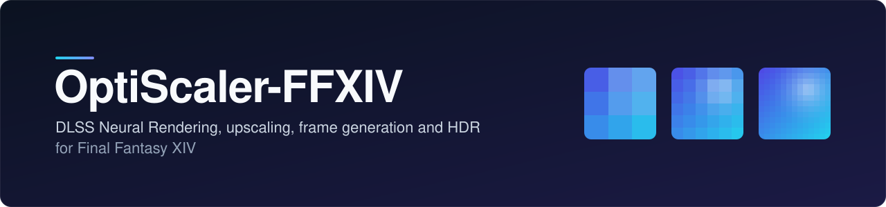

## What it is

OptiScaler-FFXIV is a fork of [OptiScaler](https://github.com/optiscaler/OptiScaler) for Final Fantasy XIV. It provides upscaling, frame generation and HDR10 output for the game, plus features written for FFXIV itself, and puts the settings in an in-game menu that opens with the Insert key. A large part of the feature code was carried over from [SirenBrink's community fork](https://github.com/SirenBrink/OptiScaler_DLSSNR_Multipass_MFG_FFXIV) (see [Credits](#credits)).

## Highlights

| Feature | What it does | Status |
|---|---|---|
| DLSS Neural Rendering | Adds detail to the upscaled image with NVIDIA's Neural Rendering model (NVIDIA RTX) | tested |
| Upscaling | The game renders below your screen resolution and DLSS, FSR or XeSS upscales it, or DLAA runs at full resolution | DLSS tested; FSR and XeSS untested |
| Frame rate governor | Steps the Neural Rendering model resolution down and up to hold a target frame rate | optional, experimental; not tried in game yet |
| Frame generation | DLSS multi frame generation at 2x to 4x on RTX 40 cards; FSR or XeSS frame generation on other cards | DLSS tested; 5x and 6x are experimental; FSR and XeSS untested |
| HDR10 output | HDR10 for the game, with RenoDX scene HDR as an option | tested |
| ReShade depth alignment | Keeps ReShade's depth lined up with the picture when the game renders below the output size, so ambient occlusion such as MXAO sits on the geometry | optional, tested with one preset |
| HUD-less frame generation | Handles the interface separately from the game picture during frame generation | optional, tested in SDR; one of its two modes is experimental |
| Character preview | DLSS, spatial anti-aliasing and Neural Rendering in the character preview | optional, tested on earlier builds with one preview window |

Tested means played in game by the author on an RTX 4090. Neural Rendering, frame generation, HDR10 output and the optional features are off until you switch them on in the menu or in `OptiScaler.ini`; upscaling follows the quality set in the game.

## Requirements

- Windows and Final Fantasy XIV (`ffxiv_dx11.exe`).
- For the DLSS features (DLSS upscaling, Neural Rendering, DLSS frame generation), an NVIDIA RTX graphics card; AMD and Intel cards use FSR or XeSS instead. Only an RTX 4090 has been tested.
- For the DLSS features, NVIDIA's own files. They cannot be redistributed here, so you bring them yourself; the [install guide](../docs/INSTALL.md) names them.
- ReShade 6.8.0, only for the ReShade features.

## Get started

1. Download the zip of the release you want from the [Releases](https://github.com/arnaudcouturier/OptiScaler-FFXIV/releases) page.
2. Close the game. In the folder that contains `ffxiv_dx11.exe`, back up the files the install guide lists.
3. Extract the zip into that folder and overwrite, then add NVIDIA's files if you use DLSS.
4. Start the game, press Insert and switch on the features you want.

The [install guide](../docs/INSTALL.md) has the details, the settings of the tested setup and the uninstall steps.

**Or let Lucent install it.** [Lucent](https://github.com/arnaudcouturier/lucent) is a separate Windows app, by the same author, that installs this fork for you, with ReShade and presets if you want them. It backs up every file it replaces, can repair its files if a game update replaces them (after a game patch the FFXIV features that hook the game's code still wait for a fork update) and uninstalls cleanly. It deploys its own tested setups, which can lag behind the newest release here. The download and the list of files it installs are on its [website](https://arnaudcouturier.github.io/lucent/); questions about Lucent go to its own [issues](https://github.com/arnaudcouturier/lucent/issues).

## Status

The current release is v0.4.0 (tag `ffxiv-2026.10.30-d9b62110`) on OptiScaler nightly `d9b62110`. It is a pre-release and has not been played in game yet. The last played release was v0.3.0 (tag `ffxiv-2026.10.26-d9b62110`, played on 2026-10-26); v0.2.0 (tag `ffxiv-2026.10.25-d9b62110`) was played on 2026-10-25 and v0.1.0 (tag `ffxiv-2026.10.23-d9b62110`) on 2026-10-23, all on one RTX 4090; other graphics cards are untested. The FFXIV features that read or hook the game's own code follow one game build and switch themselves off after a game patch until the fork is updated; the others keep running. What was and was not tested is listed in [docs/STATUS.md](../docs/STATUS.md).

## Documentation

| Document | Contents |
|---|---|
| [Install guide](../docs/INSTALL.md) | Backup, files, NVIDIA files, settings, known limits, uninstall |
| [What works](../docs/STATUS.md) | Every feature with what was tested and what was not |
| [Features and settings](../docs/FEATURES.md) | Each feature, where it comes from, its `OptiScaler.ini` keys and menu card |
| [Settings reference](../docs/SETTINGS.md) | Every `OptiScaler.ini` key, with its default, range and menu card |
| [HUD-less frame generation](../docs/HUDLESS.md) | How it works and what was measured |
| [After a game patch](../docs/FFXIV-PATCH-RUNBOOK.md) | Updating the fork for a new game build |
| [Releasing](../docs/RELEASE.md) | Building, packaging and publishing an archive, and how releases are numbered |
| [Code layout](../docs/SEAMS.md) and [upstream sync](../docs/SYNC-RUNBOOK.md) | All fork code lives under `OptiScaler/ext/`; upstream files carry only small, listed hooks |
| [Credits](../docs/ATTRIBUTION.md) | Who wrote what |
| [OptiScaler README](../README.md) | Upstream's own description of OptiScaler |

## Credits

Most of the feature code in this repository was written by other people. The full table, by area and with commits, is in [docs/ATTRIBUTION.md](../docs/ATTRIBUTION.md).

- The [OptiScaler](https://github.com/optiscaler/OptiScaler) team, for OptiScaler itself.
- [SirenBrink](https://github.com/SirenBrink/OptiScaler_DLSSNR_Multipass_MFG_FFXIV), whose community fork this repository carries over in large part: the FFXIV integration, OptiHDR and scene HDR, HDR PNG capture, XeFG/XeMFG, and frame markers and pacing (as they stood at the import base `36c53a15`), plus the NR linear-light mode, the HDR PNG menu option and the character preview (v6.0, `e17a7362`). The DLSS-G render preset, the NR model picker, the bind-time mip bias and the source-level jitter fix follow the design of his v6.0 source, with code written for this repository.
- Dagherbou (DLSS Neural Rendering base), y4my4my4m (multipass, MFG unlock), wilsjo2 (pre-SR, native path, MFG unlock hardening), byunjoe (HUD-less frame generation).
- janblade, Citrus333, Ainquisition, MatheusGViana, ShyVortex, BeliyG3, stegalloway, mavismmg and dashdogy, whose work SirenBrink's fork adapts; see the attribution table.
- [RenoDX](https://github.com/clshortfuse/renodx) (clshortfuse), the HDR shaders behind scene HDR; its notice ships with the code that uses it.

## License

GPL-3.0, the same as upstream; see [LICENSE](../LICENSE). This is an unofficial fork and is not affiliated with the OptiScaler team or Square Enix.
